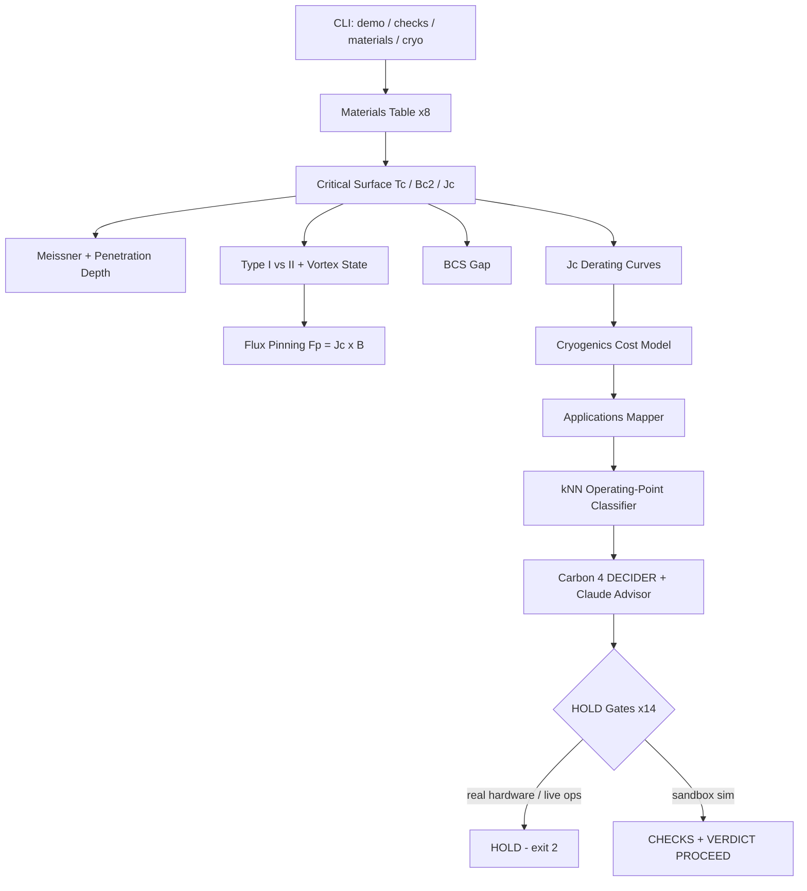
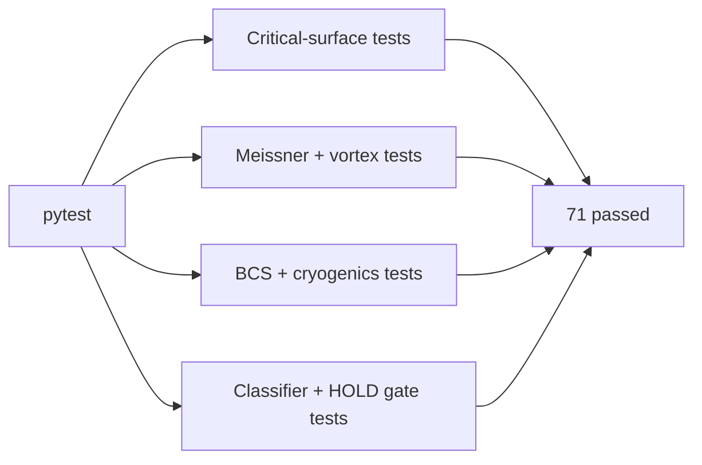
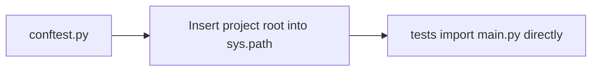
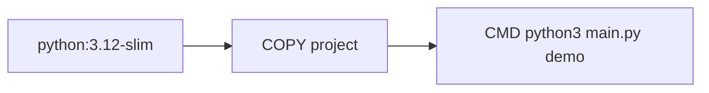

# Superconductor-Lab ❄️⚡

**Superconductor Physics & Materials Lab** — by Darion Kellar

## ❓ What is this?

Superconductor-Lab is an **educational superconductor physics and materials lab** in ONE pure-Python file — the deep-physics foundation that **LevitationX** (flux-pinning levitation) and **MagLevX** (EDS / EMS trains) stand on. It builds the subject from the ground up with **real formulas**: zero resistance, the **critical surface** in temperature / field / current space (Tc, Bc2, Jc) that a material must stay *inside* to superconduct at all, the **Meissner effect** and London penetration depth, **Type I vs Type II** behaviour and the vortex state, **flux pinning**, the **BCS energy gap**, critical-current derating curves, and a **cryogenics cost model** that shows why 77 K liquid nitrogen and 4.2 K liquid helium are different economic worlds. 🌡️

It is a simulation and learning tool only. It controls **no hardware**, designs **no magnet**, and claims **no room-temperature superconductor** — H2S carries its ~155 GPa pressure caveat everywhere it appears, and every real-world operation sits behind a permanent HOLD gate (14 total). 🔒

## 🧰 Tech Stack Badges & Full Architecture


> ℹ️ Workflow badges are static **'Pending Paste'** shields on purpose: the `ci.yml` and `docker-publish.yml` files are delivered in the local paste pack and are **not pasted yet**, so no live badge is claimed.

**📦 1. Language & Runtime**
- 🐍 Python 3.12, pure standard library (`math`, `hashlib`, `json`, `sys`)
- 🚫 Zero dependencies, zero network, deterministic (double-run byte-identical)

**⚛️ 2. Physics Core**
- 🌡️ Critical surface: Bc2(T) = Bc2(0)·(1 − t²), Jc(T,B) derating, zero-resistance check
- 🧲 Meissner screening + London penetration depth λ(T) = λ0/√(1 − (T/Tc)⁴)
- 🌀 Type I vs II, Bc1 / Bc2 vortex bands, flux-pinning force density Fp = Jc × B
- 🔬 BCS gap Δ = 1.764 kB·Tc with the standard Δ(T) interpolation

**🤖 3. AI / ML**
- 🧠 TinyML kNN operating-point classifier (from scratch, stdlib) on critical-surface ratios
- 🗺️ Applications mapper: MRI / LN2 maglev bearing / fusion field / 20 K instrument
- 🔮 Gemini Carbon 4 DECIDER seat (names-only, tighten-only) + Muse advisor (never overrides HOLD)

**🎬 4. Media / Planning**
- 🎥 Google Flow plan-only seat (rendered = False, live = 0)

**🐳 5. Infrastructure**
- 🐳 Docker (`python:3.12-slim`), GitHub Actions CI + Docker Publish (paste pack)
- 🎯 Target image: `credkellar/superconductor-lab:latest`

**🔒 6. Safety**
- ⛔ 14 HOLD gates — live cryogenics, real hardware, room-temperature-superconductor claims, medical / grid claims, and more are permanently held

## 🔬 What this does

1. 📋 **Materials table** — 8 superconductors with Tc, Bc2(0), type, and notes: Mercury (4.15 K, the 1911 original), Niobium (9.2 K), NbTi (9.8 K), Nb3Sn (18.3 K), MgB2 (39 K), YBCO (92 K), BSCCO (110 K), and H2S (203 K — **only at ~155 GPa**, labelled everywhere).
2. 🧊 **Critical surface** — a point (T, B, J) is superconducting only inside the boundary: `Bc2(T) = Bc2(0)(1 − t²)` and `Jc(T,B) = Jc0(1 − t)^1.5(1 − B/Bc2(T))`; the state function names exactly which wall you crossed.
3. ⚡ **Zero resistance** — resistance is exactly 0.0 inside the surface and the normal-state value outside it. No gradual fudge.
4. 🧲 **Meissner effect** — field expulsion with London screening `B(x) = B0·e^(−x/λ)` and `λ(T) = λ0/√(1 − (T/Tc)⁴)`, which diverges as T → Tc.
5. 🌀 **Type I vs Type II** — Type I expels completely then quits; Type II admits quantized vortices between Bc1 and Bc2. The vortex state is where the useful physics lives.
6. 📌 **Flux pinning** — pinning force density `Fp = Jc × B`, peaking at Bc2/2, converted to a levitation pressure — the exact bridge number LevitationX and MagLevX consume.
7. 🔬 **BCS gap** — `Δ(0) = 1.764 kB Tc` (Nb ≈ 1.40 meV, YBCO ≈ 13.98 meV), the universal ratio 2Δ/kBTc = 3.528, and the tanh interpolation for Δ(T).
8. 📉 **Jc derating curves** — deterministic tables of critical current vs temperature and vs field.
9. 🧮 **Cryogenics cost model** — Carnot COP, ideal wall-plug watts per cooling watt, and a labelled practical estimate at 20% of Carnot: cooling at 4.2 K costs ~24× the wall power of 77 K. Plus a coolant picker (He / H₂ / Ne / N₂) per operating point.
10. 🗺️ **Applications mapper + kNN classifier** — four named applications mapped to the materials that actually fit, and a from-scratch kNN that labels any operating point `qualifies` / `marginal` / `no` from its surface ratios.
11. 🧠 **Advisory seats + checks** — Carbon 4 DECIDER with sha256 trace, Muse advisor, Google Flow plan-only, and a built-in CHECKS suite (54 checks).

## 🗺️ How it works — diagram per script

### `main.py` — the whole lab



### `tests/test_main.py` — verification



### `conftest.py` — test path setup



### `Dockerfile` — container



## 🤩 Why is this cool?

1. 🧊 The whole subject hangs on one picture — the critical surface — and this lab makes you *compute* with it.
2. ⚡ Zero resistance is not a slogan here: cross any of the three walls and the resistance snaps back in the numbers.
3. 🧲 The Meissner effect comes with its ruler: one penetration depth deep, exactly 1/e of the field survives.
4. 🌀 Vortices sound like a defect — the lab shows they are the feature: pinning is what levitates trains and frogs' worth of magnets.
5. 📌 The pinning-pressure number plugs straight into LevitationX — the labs form one physics stack, not six islands.
6. 🔬 BCS gives you a real energy gap from one constant: measure Tc and you know Δ to three figures.
7. 💸 The cryogenics model explains in one ratio (~24×) why the entire magnet industry prays for higher Tc.
8. 🗺️ The applications mapper settles bar arguments: why MRI is NbTi, why fusion outgrew it, why MgB2 owns 20 K.
9. 🏷️ A tiny from-scratch ML classifier learns the shape of the critical surface from ratios alone.
10. 🎯 Deterministic end to end: run it twice, get byte-identical output — physics you can diff.

## 🛠️ What problems this solves?

1. ❌ **Problem:** "Superconductor" gets treated as a magic material property. ✅ **Solution:** The lab shows it is a *region* — leave the (T, B, J) region and it switches off, with the crossed wall named.
2. ❌ **Problem:** Room-temperature superconductor hype cycles fool everyone yearly. ✅ **Solution:** H2S's 203 K carries its ~155 GPa caveat in the data itself, and room-temperature claims are a permanent HOLD gate.
3. ❌ **Problem:** Tc is quoted like a spec-sheet score while Bc2 and Jc are ignored. ✅ **Solution:** All three walls are computed together; a high-Tc material can still fail your field or current.
4. ❌ **Problem:** Type I vs Type II is memorized, not understood. ✅ **Solution:** The vortex-band function shows exactly which state you are in and why Type II does the work.
5. ❌ **Problem:** Flux pinning looks like levitation magic in videos. ✅ **Solution:** Fp = Jc × B and a pressure number connect pinning to lift force step by step.
6. ❌ **Problem:** Nobody explains why liquid helium bills dominate magnet labs. ✅ **Solution:** Carnot math: ~70 ideal wall watts per cooling watt at 4.2 K vs ~2.9 at 77 K.
7. ❌ **Problem:** Material choice for a magnet is folklore ("just use YBCO"). ✅ **Solution:** The applications mapper tests every material against the actual (T, B, J) point.
8. ❌ **Problem:** BCS gap values get quoted without the temperature dependence. ✅ **Solution:** Δ(T) interpolation shows the gap closing as T → Tc.
9. ❌ **Problem:** Physics code usually needs numpy / scipy installs. ✅ **Solution:** Pure standard library — runs anywhere Python 3.12 runs, zero pip installs for the lab itself.
10. ❌ **Problem:** Simulation tools quietly imply engineering readiness. ✅ **Solution:** Model constants are labelled as model values, operating points carry "not an engineering design", and 14 HOLD gates return exit code 2 for every live operation.

## 📥 How to install step-by-step

1. 📋 Clone or download this project folder.
2. 🐍 Make sure Python 3.12+ is installed: `python3 --version`
3. ▶️ Run the full demo + checks (no arguments needed):

```bash
python3 main.py
```

4. 🧪 Run the test suite:

```bash
pip install pytest
python3 -m pytest -q
```

5. 🎛️ Try the other commands:

```bash
python3 main.py checks     # 54 built-in checks
python3 main.py materials  # the 8-material table as JSON
python3 main.py surface    # who is superconducting at 4.2 K, 3 T, 200 A/mm^2
python3 main.py meissner   # penetration depths
python3 main.py vortices   # NbTi state vs field
python3 main.py gap        # BCS gap per material
python3 main.py cryo       # Carnot economics + operating points
python3 main.py apps       # applications mapper
python3 main.py classify   # kNN verdicts at the reference point
python3 main.py brains     # Carbon 4 + Muse + Flow seats
python3 main.py holds      # list all 14 HOLD gates
python3 main.py hold-demo  # exits 2 - gated actions stay HOLD
```

6. 🐳 Or run it in Docker:

```bash
docker build -t credkellar/superconductor-lab:latest .
docker run --rm credkellar/superconductor-lab:latest
```

## 📋 Requirements

- 🐍 Python 3.12 or newer
- 📦 Dependencies: **none** (standard library only)
- 🌐 Network: **none** — fully offline
- 🧪 For tests only: `pytest`
- 🐳 Optional: Docker

## 🧒 5th-grade English section

Some special stuff can carry electricity **forever** without wasting any — but only when it is **super, super cold**. ❄️

- Every one of these materials has a **cold limit** called Tc. Warmer than that? It stops being special. 🌡️
- It also has a **magnet limit** and an **electricity limit**. Cross any one of the three limits and the magic turns off. This lab draws that invisible box and tests points inside and outside it. 📦
- A superconductor **pushes magnets away** from its skin. That push is called the **Meissner effect**, and it only reaches a tiny depth inside — thinner than a hair is wide. 🧲
- Some kinds let tiny magnetic **whirlpools** inside, called vortices. If the whirlpools get stuck — **pinned** — they act like springs. That is how a magnet can float steady above a super-cold disc! 🛸
- Keeping things at the coldest temperatures costs a **lot** of electricity for the fridge. Cold like outer space (4 K) costs about 24 times more fridge power than merely very cold (77 K). That is why scientists hunt for materials that work warmer. 💸
- One material in the lab works at a warm-ish 203 K — but only when squeezed harder than almost anything on Earth. Squeezing is not the same as room temperature! 🤏
- This project is a **pretend lab on a computer**. It does not cool anything real or build real magnets. It helps you learn how the coldest trick in physics really works. 💻

## 🌳 Full file tree

```text
superconductor-lab/
├── main.py                  # the whole lab: critical surface, Meissner, vortices, BCS, cryo, classifier, seats, HOLD gates
├── conftest.py              # puts the project root on sys.path for tests
├── tests/
│   └── test_main.py         # 71 pytest tests: surface, Meissner, BCS, cryo, classifier, gates, determinism
├── assets/
│   └── cover.png            # README cover image (2736 x 912)
├── Dockerfile               # python:3.12-slim, runs the demo
└── README.md                # this file
```

> 📦 Delivered separately as paste packs (not in this tree): `.github/workflows/ci.yml` + `docker-publish.yml`, and the Docker Hub pack (100-char description, 350-char About, overview, categories).

---

MIT © 2026 Darion Kellar · Superconductor-Lab — educational simulation only ❄️
